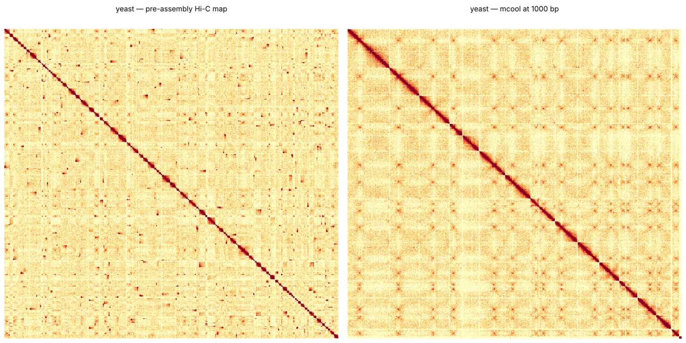

# instaGRAAL

[](https://pypi.org/project/instagraal/)

[](https://github.com/koszullab/instaGRAAL/actions/workflows/test-cpu.yml)
[](https://koszullab.github.io/instagraal/)
[](https://doi.org/10.1186/s13059-020-02041-z)
[](https://opensource.org/licenses/GPL-3.0)

Chromosome-level scaffolding of genomes from Hi-C contacts: instaGRAAL orders
and orients the contigs of an assembly into chromosomes from the contacts of a
Hi-C library, with an MCMC on a GPU (a continuation and rewrite of
[GRAAL](https://github.com/koszullab/GRAAL)) and a refinement that joins whole
contigs from the contacts at their ends, and writes the contact maps of the
new assembly.

<p align="center">
  
</p>

**Documentation: <https://koszullab.github.io/instagraal/>**:
[quickstart](https://koszullab.github.io/instagraal/quickstart/),
[the end-to-end pipeline](https://koszullab.github.io/instagraal/end-to-end/),
[concepts](https://koszullab.github.io/instagraal/concepts/),
[CLI reference](https://koszullab.github.io/instagraal/cli/) and
[file formats](https://koszullab.github.io/instagraal/formats/).

## Installation

```sh
pip install instagraal            # every step but the MCMC scaffolder, on any machine
pip install "instagraal[gpu]"     # with the MCMC scaffolder: an NVIDIA GPU and the CUDA toolkit
```

instaGRAAL needs Python 3.10 to 3.12. Docker images with CUDA are at
`ghcr.io/koszullab/instagraal`. See
[Installation](https://koszullab.github.io/instagraal/installation/) and
[GPUs, CUDA and Docker](https://koszullab.github.io/instagraal/guides/gpu/).

## Usage

instaGRAAL starts from the contigs and the Hi-C read pairs aligned on them,
in the [pairs format](https://github.com/4dn-dcic/pairix/blob/master/pairs_format_specification.md),
which [hicstuff](https://github.com/koszullab/hicstuff) writes:

```sh
# The Hi-C pairs on the contigs: hicstuff/sample.valid_idx.pairs.gz
hicstuff pipeline -g contigs.fa -e DpnII,HinfI -M none -o hicstuff -P sample R1.fq.gz R2.fq.gz

# The contigs to chromosomes: out/final_genome.fa
instagraal-endtoend contigs.fa hicstuff/sample.valid_idx.pairs.gz --enzyme DpnII,HinfI --output-dir out
```

`--mode` chooses the steps:

| Mode | Steps | GPU | What it does |
|---|---|---|---|
| `default` | `mcmc,refine` | yes | MCMC scaffolding from the contigs, then `instagraal-refine` |
| `cpu` | `refine,extend` | no | `instagraal-refine` alone: the most contiguous assemblies |
| `legacy` | `bomb,mcmc,polish` | yes | The pipeline of instaGRAAL 0.2.0 |

It writes, in `out/`, the scaffolds (`final_genome.fa`) and their layout
(`final_info_frags.txt`); the contact maps of the scaffolds (`post/`,
among them a multi-resolution `.mcool` file); and the outputs of each step.
Each step is also a command:

| Command | What it does |
|---|---|
| `instagraal-endtoend` | Runs the pipeline. |
| `instagraal-pre` | Makes the contact map of the restriction fragments, from the contigs and the pairs. |
| `instagraal` | Scaffolds the contigs with the MCMC, on a GPU. |
| `instagraal-polish` | Polishes the MCMC scaffolds. |
| `instagraal-refine` | Joins whole contigs from the contacts next to their ends, and scores the joins of a layout. |
| `instagraal-post` | Lifts the pairs over to the scaffolds, and writes their contact maps. |
| `instagraal-stats` | Prints the statistics of assemblies, side by side. |
| `instagraal-test` | Checks a GPU installation on a test dataset. |

`<command> --help` lists the options of each. The
[quickstart](https://koszullab.github.io/instagraal/quickstart/) runs
instaGRAAL on the test data of this repository, in a minute, without a GPU.

## Upgrading

`instagraal-endtoend` now runs `--mode default` (`--mode legacy` for the
pipeline of 0.2.0), and pycuda is the `gpu` extra.
[Upgrading](https://koszullab.github.io/instagraal/upgrading/) lists every
change, from 0.2.0 and from 0.1.

## Contributing

Contributions are welcome: see
[CONTRIBUTING.md](https://github.com/koszullab/instaGRAAL/blob/master/CONTRIBUTING.md).

## Citation

> Lyam Baudry, Nadège Guiglielmoni, Hervé Marie-Nelly, Alexandre Cormier,
> Martial Marbouty, Komlan Avia, Yann Loe Mie, Olivier Godfroy, Lieven Sterck,
> J. Mark Cock, Christophe Zimmer, Susana M. Coelho and Romain Koszul. 2020.
> instaGRAAL: chromosome-level quality scaffolding of genomes using a
> proximity ligation-based scaffolder. *Genome Biology* 21: 148.
> <https://doi.org/10.1186/s13059-020-02041-z>

GRAAL, BibTeX and the studies that use instaGRAAL:
[Citing instaGRAAL](https://koszullab.github.io/instagraal/citation/).

## License

instaGRAAL is distributed under the GNU General Public License v3 (GPLv3): see
[LICENSE](https://github.com/koszullab/instaGRAAL/blob/master/LICENSE).

## Contact

* romain.koszul@pasteur.fr

[Spatial Regulation of Genomes](https://research.pasteur.fr/en/team/spatial-regulation-of-genomes/) (Institut Pasteur, Paris)
