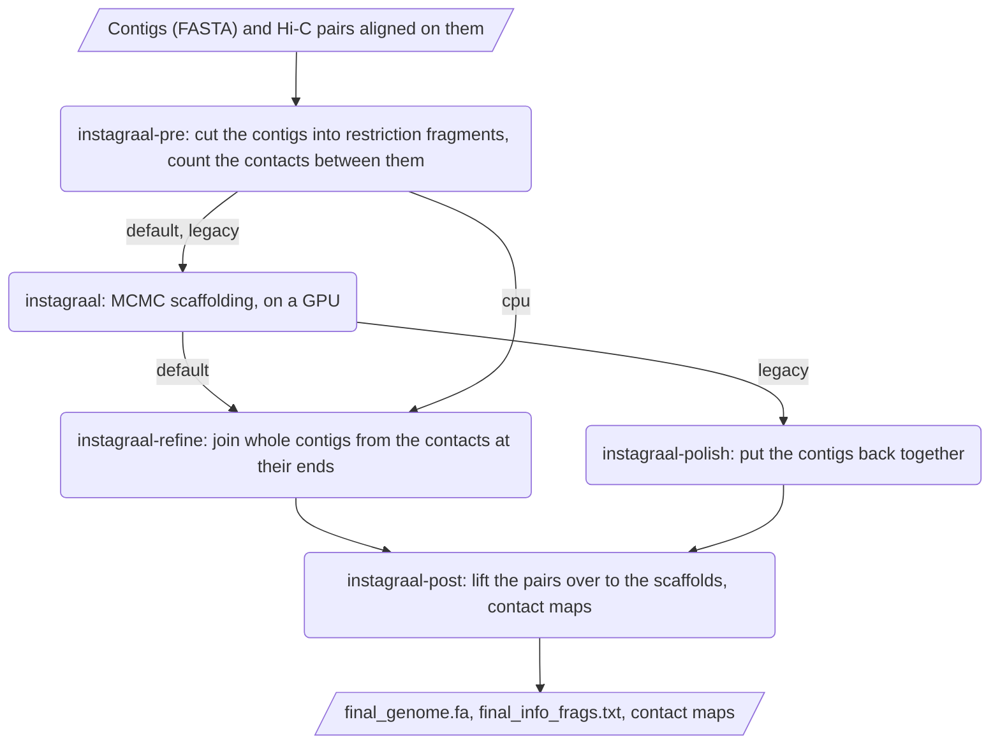

# Concepts

How instaGRAAL scaffolds, and the terms the documentation uses. For file
layouts, see [File formats](formats.md).

## The signal

A Hi-C library cross-links the chromosomes in the nucleus (or the cell), then
digests the DNA with restriction enzymes, ligates the ends that lie close in
space and sequences the junctions, as read pairs. Two loci of one chromosome
touch far more often than loci of different chromosomes, and the closer they
lie along the chromosome, the more often: the contact frequency decays with
the genomic distance *s*, roughly as a power of it. A layout of the contigs
that puts contacting contigs next to each other, in the right orientation,
recovers the chromosomes.

## The pipeline

`instagraal-endtoend` runs these steps; its `--mode` says which ones (see
[Running the pipeline](guides/pipeline.md#modes)).

## Fragments and the contact map

`instagraal-pre` cuts each contig at the restriction sites of `--enzyme` into
**restriction fragments**, and counts the read pairs between every two
fragments: the **contact map** of the fragments. The test data, 146 contigs
of yeast cut with DpnII and HinfI, has 75,032 fragments. The contact map is
written both as instaGRAAL's own three text files and as a cool file (see
[Preparing the contacts](guides/pre.md)).

## Levels and bins

The MCMC scaffolder works on **bins** of consecutive fragments of a contig,
not on single fragments: a **pyramid** of contact maps, each level grouping
three bins of the level below. `--level` picks the level the scaffolder works
at (4 by default); each level up makes about three times fewer bins, and a
faster run. A contig keeps at least one bin, so the bins stop growing once
the contigs run out of fragments. On the test data:

| Level | Bins | Mean size |
|---|---|---|
| 0 (fragments) | 51,417 | 234 bp |
| 1 | 17,191 | 701 bp |
| 2 | 5,784 | 2.1 kb |
| 3 | 1,981 | 6.1 kb |
| 4 (default) | 727 | 16.6 kb |
| 5 | 332 | 36.3 kb |
| 6 | 239 | 50.4 kb |

Before binning, the **coverage filter** removes the fragments in contact with
too few others: fewer than the mean minus `--coverage-std` standard deviations
(1 by default), along with any in contact with far too many (more than the
mean plus 50 standard deviations). On the test data it removes 23,615 of the
75,032 fragments, 3.7 of the 12.2 Mb, which is why level 0 has 51,417. The
scaffolder never sees that DNA; polishing and refining put it back.

## The model and the MCMC

A **layout** puts the bins in scaffolds, in an order and an orientation. Its
likelihood is that of the observed contacts under a model of the expected
ones: between two bins of one scaffold, a contact frequency that decays with
their distance along it, following a polymer model of the chromosome
([Rippe, 2001](https://doi.org/10.1016/S0968-0004(01)01978-8)); between bins
of different scaffolds, a constant frequency. The parameters of the model are estimated from the contacts, and
re-estimated as the layout changes.

Each **cycle** visits every bin, in a random order. For each, the scaffolder
takes its `--neighborhood` bins of most contacts (5 by default) and tries
moves that bring them together: insert the bin next to one of them, on
either side and in either orientation; flip or eject it; swap the ends of
their scaffolds; scramble their surroundings. It computes the likelihood of
every move on the GPU, and applies the most likely. `--cycles` sets how many
cycles run: 100 by default, 10 when refine follows. After each cycle, the
current layout is written, as `genome.fasta` and `info_frags.txt`.

The MCMC starts from the contigs, their bins in order. With `bomb`, it starts
from the bins instead, each its own scaffold, as `instagraal-endtoend` did up
to 0.2.0 (the `legacy` mode). [Scaffolding on a GPU](guides/scaffolding.md)
gives the options.

## Refining

The model knows only one structure: contacts that decay with the distance
along a chromosome. In many bacteria, the two replication arms of a
chromosome are aligned, so a locus also touches its mirror locus on the
other arm about as often as its neighbours, which draws an X across the
contact map. The MCMC explains those contacts by folding the chromosome and
interleaving its arms: the map looks smooth, but the scaffold is wrong.

`instagraal-refine` scores every pair of contig ends from the contacts
between the 50 kb next to each end (`--window`), only. It compares them, as a
log-likelihood ratio, with what a direct junction would give (the decay
measured inside the contigs) and with the background between contigs, and
joins two ends when each is the other's best partner, by a clear margin.
Long-range contacts, which carry the X, play no part. Then:

- **Short contigs** (under 15 kb, `--min-contig-length`) carry too few
  contacts to be joined: each is placed, whole, where its contacts fit best,
  if that place clearly beats the others.
- **Circular chromosomes**: a scaffold of at least 500 kb whose two ends
  would join is circular. It is cut at its replication origin, found from its
  GC skew, so that it reads like a reference genome.
- **A second pass** joins whole scaffolds over 200 kb windows, which
  recovers joins too weak locally (gaps, low coverage). Since it relies on
  longer-range contacts, the `default` mode runs it only if refine confirms
  at least 30% of the MCMC's joins: a layout that the X did not fold.

Refine keeps contigs whole: it cannot correct a misassembled contig, and its
scaffolds are as good as the contacts at contig ends. It also scores the
joins of the layout it is given, which makes a reference-free check of any
layout. [Refining the scaffolds](guides/refine.md) says more.

## Polishing

The MCMC moves bins, not contigs: it can split a contig, flip part of it, or
lose its bins to the coverage filter. `instagraal-polish` brings the bins of
each contig back together within each scaffold, next to their longest run,
puts each run of bins of a contig back in its order and in its majority
orientation, and reinserts the DNA the scaffolder left out next to its
neighbours on the contigs. It keeps the order of the contigs that the MCMC
chose. The `legacy` mode polishes the MCMC scaffolds; the `default` mode
writes them as they are and refines them instead. See
[Polishing the scaffolds](guides/polishing.md).

## Junctions

Where two contigs (or bins of different contigs) meet in a scaffold, the
FASTA holds a **junction**: `NNNNNN` by default (`--junction`), to mark a gap
of unknown length. `instagraal-post` rebuilds the coordinates of the
scaffolds from their layout, so it must be told the length of that junction:
`instagraal-endtoend` passes it on.

## Contact maps of the assembly

`instagraal-post` lifts every read pair over from the contigs to the
scaffolds, through their layout, and writes the contact maps of the new
assembly: a multi-resolution `.mcool` file, a cool file with one bin per
scaffold, and one with one bin per contig, in the new order. A good assembly
has its contacts on the diagonal of each scaffold, and no square or stripe
that breaks the decay. See [Contact maps of the assembly](guides/post.md).
