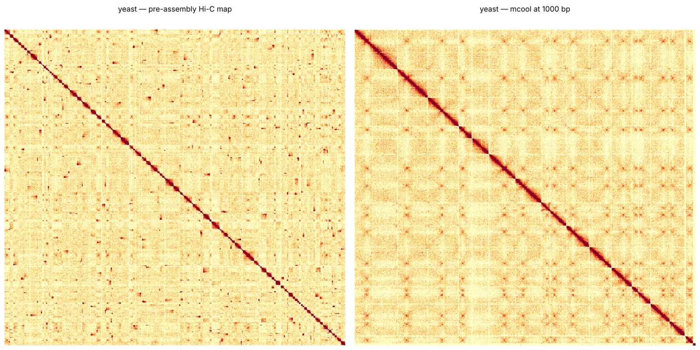

# Quickstart

This page scaffolds the test data of instaGRAAL's repository: 146 contigs
(12.2 Mb) cut from the genome of the yeast *Saccharomyces cerevisiae*, and 1.3
million Hi-C read pairs aligned on them. It runs on any machine, without a
GPU, in about a minute. For a real sample, see
[The end-to-end pipeline](end-to-end.md).

## Input files

| File | What it is |
|---|---|
| `yeast.contigs.fa.gz` | The contigs (FASTA) |
| `yeast.pairs.gz` | The Hi-C read pairs aligned on the contigs, from a library cut with DpnII and HinfI ([pairs format](formats.md#pairs)) |

```bash
base=https://raw.githubusercontent.com/koszullab/instaGRAAL/master/tests/data
curl -LO "$base/yeast.contigs.fa.gz"
curl -LO "$base/yeast.pairs.gz"
```

The same files are archived on Zenodo
([10.5281/zenodo.19813387](https://doi.org/10.5281/zenodo.19813387));
`scripts/generate_test_data.sh` in the repository makes them from the yeast
reference genome and a public Hi-C library.

## Step 1: run the pipeline

```bash
instagraal-endtoend yeast.contigs.fa.gz yeast.pairs.gz --enzyme DpnII,HinfI \
    --mode cpu --output-dir out
```

- `--enzyme` gives the restriction enzymes of the library: `instagraal-pre`
  cuts the contigs into restriction fragments and counts the pairs between
  them.
- `--mode cpu` runs `instagraal-refine` alone, which re-joins whole contigs
  from the contacts next to their ends, with no GPU. The default mode runs the
  MCMC scaffolder first, on a GPU (see [step 5](#step-5-with-a-gpu)).

The run prints each step and the command it runs (excerpt):

```console
Mode             : refine (extend: on)  (no GPU needed)

[1/4] Running instagraal-pre …
  $ instagraal-pre yeast.contigs.fa.gz yeast.pairs.gz --enzyme DpnII,HinfI --output-dir out/pre
...
[2/5] Digesting genome with enzyme(s): DpnII, HinfI
      → 75,032 restriction fragments
...
[4/5] Binning pairs into fragment contact matrix: yeast.pairs.gz
      → 1,335,066 valid pairs, 857,719 non-zero pixels
...
[2/4] Running instagraal-refine …
  $ instagraal-refine --cool out/pre/yeast.cool --fasta yeast.contigs.fa.gz --output-dir out/refined --junction NNNNNN --extend on
...
Refined: 103 joins (103 new) + 3 from the second pass, 16 scaffolds, N50 924,431 bp (input N50 154,018 bp)
  second pass over whole scaffolds (200 kb windows): 3 joins (--extend on)
  contigs < 15,000 bp: 24 of 25 (177,354 bp) placed from their contacts (margin 10.0); the others (4,248 bp) are scaffolds of their own
...
[3/4] Running instagraal-post …
...
[4/4] Running instagraal-stats …
...
[instagraal-endtoend] ALL STEPS COMPLETED  (total time: 61.3s).
```

It ends with the commands it ran, to run the steps again one by one (see
[Running the pipeline](guides/pipeline.md#running-the-steps-one-by-one)).

## Step 2: look at the outputs

```console
$ ls out out/post out/refined
out:
final_genome.fa  final_info_frags.txt  post  pre  refined

out/post:
yeast_contigs.cool  yeast_lifted.pairs.gz  yeast_scaffolds.cool  yeast_scaffolds_binned.mcool
yeast_contigs.png   yeast_ps_curves.png    yeast_scaffolds.png   yeast_scaffolds_binned_1000.png

out/refined:
junctions.tsv  refine_report.txt  refined_genome.fa  refined_info_frags.txt
```

| File | What it holds |
|---|---|
| `final_genome.fa` | The scaffolds: the assembly instaGRAAL made, whatever the mode |
| `final_info_frags.txt` | Their layout: the contigs of each scaffold, in order, with their orientation ([info_frags](formats.md#info_frags-files)) |
| `pre/` | The contacts between the restriction fragments of the contigs, as instaGRAAL's input folder and as `yeast.cool` |
| `refined/` | What `instagraal-refine` wrote: the scaffolds, their layout, the score of every junction (`junctions.tsv`) and a report |
| `post/` | The contact maps of the scaffolds: `yeast_scaffolds_binned.mcool` at 1 kb, the pairs lifted over to the scaffolds, and pictures |

[Running the pipeline](guides/pipeline.md#outputs) lists every output, and
[File formats](formats.md) describes them.

## Step 3: compare the assemblies

`instagraal-stats` prints the statistics of the input contigs and of the
scaffolds side by side, at the end of the run:

```console
  Assembly statistics comparison
  ------------------------------------------------------------
  Metric                    Input assembly  Refined assembly
  ------------------------------------------------------------
  Sequences                            146                16
  Total length (bp)             12,157,105        12,157,885
  Largest (bp)                     395,707         1,532,011
  Shortest (bp)                      1,470             4,248
  Mean length (bp)                83,267.8         759,867.8
  Median length (bp)              56,311.5         798,809.5
  N50 (bp)                         154,018           924,509
  L50                                   27                 6
  N90 (bp)                          48,178           666,858
  L90                                   84                12
  GC content                        38.15%            38.15%
  ------------------------------------------------------------
```

The scaffolds are 780 bp longer than the contigs: `NNNNNN` joins each pair of
contigs (130 junctions).

## Step 4: look at the contact maps



Left, `out/pre/yeast_hic_map.png`: the contacts between the 146 contigs, in
the order of the FASTA file. Right, `out/post/yeast_scaffolds_binned_1000.png`:
the contacts between the 16 scaffolds, lifted over from the same pairs. Each
square along the diagonal is a chromosome, and the dots between them are the
contacts between centromeres, which cluster in the yeast nucleus.

The contigs of the test data were cut from the yeast reference genome, and
their names record where (`>contig_002 from_X:344445-519617`), so the result
can be checked. Of the 16 chromosomes, 11 come out whole, in order and
orientation, and chromosome VII whole with one 10 kb contig flipped;
chromosomes I and IX, and III and V, are joined end to end, with the first
4 kb of chromosome V on their own (the shortest scaffold). The mitochondrial
genome is one scaffold. [Checking an assembly](guides/checking.md) shows how
to judge a real assembly, which has no reference.

## Step 5: with a GPU

The default mode runs the MCMC scaffolder from the contigs, on the GPU, then
refine, which checks the MCMC layout and joins whole scaffolds over longer
distances where it agrees with it:

```bash
pip install "instagraal[gpu]"   # needs the CUDA toolkit
instagraal-endtoend yeast.contigs.fa.gz yeast.pairs.gz --enzyme DpnII,HinfI \
    --output-dir out-gpu
```

`--dry-run` prints the commands of a mode without running them, and needs no
GPU. [Running the pipeline](guides/pipeline.md#modes) compares the modes.
`instagraal-test` runs the scaffolding pipeline on this dataset to check a GPU
installation (see [Installation](installation.md#with-the-mcmc-scaffolder-gpu)).

## The same from Python

```python
import cooler
from instagraal.assembly_stats import compute_assembly_stats
from instagraal.parse_info_frags import parse_info_frags

# N50, L50, GC content…
stats = compute_assembly_stats("out/final_genome.fa")
# For each scaffold, its contigs: [contig, id, start, end, orientation]
layout = parse_info_frags("out/final_info_frags.txt")
# The contact map of the scaffolds at 1 kb, and that of the first one
clr = cooler.Cooler("out/post/yeast_scaffolds_binned.mcool::resolutions/1000")
clr.chromnames
clr.matrix(balance=True).fetch("refined_scaffold_1")
```

## Next steps

- [The end-to-end pipeline](end-to-end.md): from the reads to chromosomes.
- [Showcase](showcase.md): genomes binned from a metagenome, scaffolded and
  checked against their references.
- [Concepts](concepts.md): how instaGRAAL scaffolds.
- [Running the pipeline](guides/pipeline.md): the modes, every output, and the
  steps one by one.
- [CLI reference](cli.md): every command.
