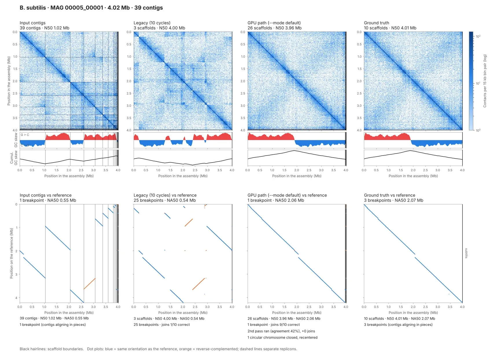
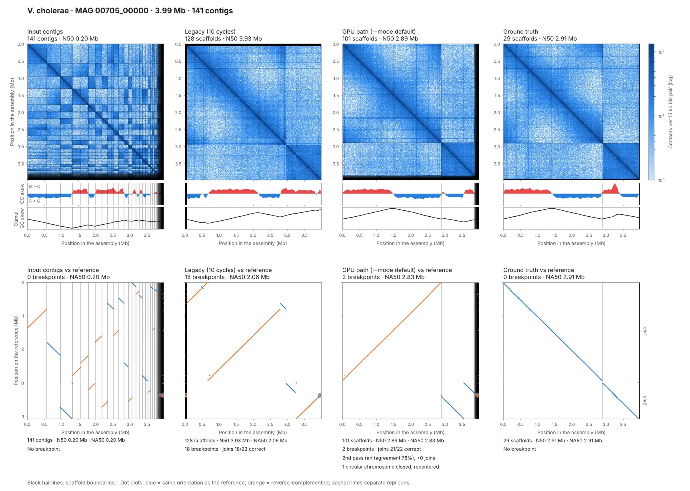
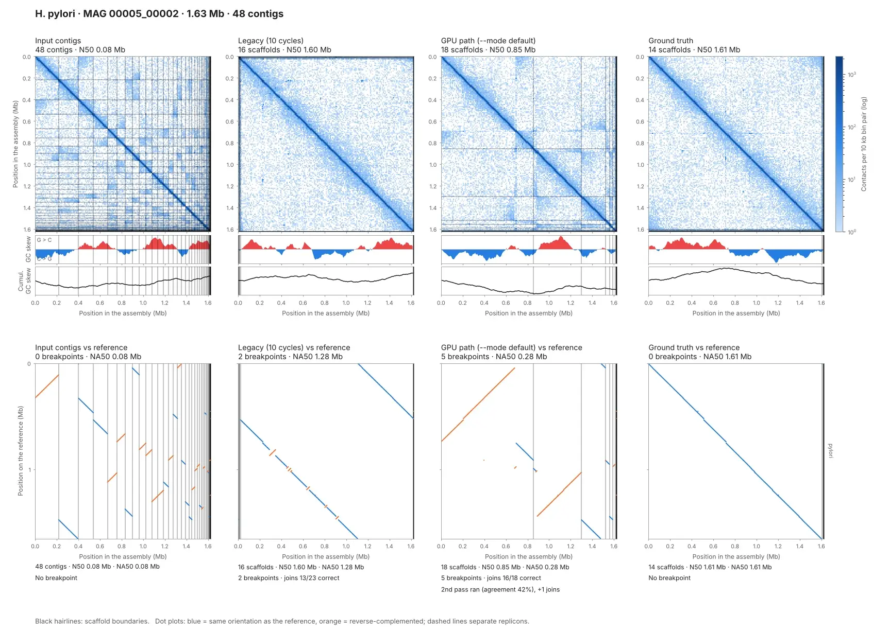

# Showcase: genomes from a metagenome

A real test, with a ground truth. MM133 is a Hi-C library of a mock
community: a mix of microbes whose genomes are known. Its
shotgun assembly was binned into genomes with [metaTOR](https://koszullab.github.io/metator/),
and instaGRAAL then scaffolded each of the 27 best bins (completeness above
80%, redundancy below 1.05). 23 of them come from a species of the
community, so every assembly can be compared with the reference genome.

This page scaffolds one of them, *Bacillus subtilis*, in a few seconds and
without a GPU, then compares the modes of `instagraal-endtoend` on three
genomes and across all 27.

## The data

The files are public, in the `rsglab-data` bucket (Amazon S3, `eu-west-3`),
under `https://rsglab-data.s3.amazonaws.com/meta/`:

| Path | What it holds |
|---|---|
| `instagraal/MM133_metator_<bin>.fa` | The contigs of each genome, as metaTOR binned them |
| `instagraal/MM133_metator_<bin>.cool` | metaTOR's contact map of each genome, at 1 kb |
| `instagraal_mags_c10/pairs/MM133_metator_<bin>.pairs.gz` | The Hi-C pairs with both mates in the genome |
| `instagraal_mags_c10/annotation.tsv` | Each genome's species, purity, completeness, and coverage of its reference |

The library was cut with DpnII and HinfI. The pairs files keep the header of
the whole metagenome: their `#chromsize` lines list all its 20,566 contigs.

| Genome | Species | Size | Contigs | Replicons |
|---|---|---|---|---|
| `00005_00001` | *Bacillus subtilis* | 4.02 Mb | 39 | one chromosome |
| `00705_00000` | *Vibrio cholerae* | 3.99 Mb | 141 | two chromosomes |
| `00005_00002` | *Helicobacter pylori* | 1.63 Mb | 48 | one chromosome |

## Run it yourself

### From the pairs

```bash
base=https://rsglab-data.s3.amazonaws.com/meta
curl -LO "$base/instagraal/MM133_metator_00005_00001.fa"
curl -LO "$base/instagraal_mags_c10/pairs/MM133_metator_00005_00001.pairs.gz"

instagraal-endtoend MM133_metator_00005_00001.fa MM133_metator_00005_00001.pairs.gz \
    --enzyme DpnII,HinfI --mode cpu --output-dir bsub
```

It runs in about ten seconds. Refine joins 10 of the 11 contigs of 15 kb or
more into one scaffold, places 4 of the 28 shorter ones in it, finds that the
scaffold is a circular chromosome, and cuts it at its replication origin:

```console
Refined: 9 joins (9 new), 26 scaffolds, N50 3,964,859 bp (input N50 1,015,647 bp)
  second pass over whole scaffolds (200 kb windows): 0 joins (--extend on)
  contigs < 15,000 bp: 4 of 28 (24,974 bp) placed from their contacts (margin 10.0); the others (28,276 bp) are scaffolds of their own
Circular scaffolds (>= 500,000 bp, outer ends joined if cycles were allowed): 1
  refined_scaffold_1: 3,964,859 bp, closure score 34.0; recentered on its GC skew: origin at 0 bp, terminus at 1,914,859 bp (replichores 48% / 52%, skew fits 99%)
...
  Metric                    Input assembly  Refined assembly
  ------------------------------------------------------------
  Sequences                             39                26
  Total length (bp)              4,015,122         4,015,206
  Largest (bp)                   1,041,876         3,964,943
  N50 (bp)                       1,015,647         3,964,943
```

The reference chromosome is 4.22 Mb, and the genome covers 96% of it: the
3.96 Mb scaffold is that chromosome, in the order of the reference but for
one breakpoint (see [below](#bacillus-subtilis)). The 25 other scaffolds are
single contigs, 50 kb in all: 24 short ones, and one of 22 kb.

### From metaTOR's contact map

Refine needs only the contigs and a contact map of them: metaTOR's map of
the genome works as well as the one `instagraal-pre` makes from the pairs,
and gives the same scaffolds, in a second:

```bash
curl -LO "$base/instagraal/MM133_metator_00005_00001.cool"
instagraal-refine --cool MM133_metator_00005_00001.cool --fasta MM133_metator_00005_00001.fa \
    --extend on --junction NNNNNN --output-dir bsub-refine
```

### With a GPU

The `default` mode runs 10 MCMC cycles first, then refine, which checks the
MCMC layout before its second pass:

```bash
instagraal-endtoend MM133_metator_00005_00001.fa MM133_metator_00005_00001.pairs.gz \
    --enzyme DpnII,HinfI --output-dir bsub-gpu
```

On this genome it gives the same assembly: refine confirms 42% of the MCMC's
joins, runs its second pass, and that pass finds nothing more to join.

## Three genomes against their references

Each figure has one column per assembly: the input contigs, the `legacy`
pipeline (MCMC from the bins, then polish), the `default` mode (MCMC, then
refine), and the ground truth, the contigs in the order of the reference. On
these three genomes the `cpu` mode gives the same assembly as `default`.
Click a figure to open it at full size.

- **Top**: the contact map of the assembly, with its GC skew and the
  cumulative skew beneath. Black lines are the boundaries of the scaffolds.
  A whole circular chromosome, cut at its origin, has a positive skew on its
  first half and a negative one on the second, like the ground truth.
- **Bottom**: where each contig aligns on the reference, in the order of the
  assembly. A correct scaffold is a straight line: blue where it reads as the
  reference, orange where reverse-complemented (both strands are right).

All MCMC runs had 10 cycles.

### *Bacillus subtilis*

[](images/showcase/b-subtilis.webp)

*Legacy* puts the genome in 3 scaffolds, but folded: its skew changes sign
over and over, and only 1 of its 10 joins between large contigs is right (25
breakpoints). *Default* and *cpu* make the same assembly: 9 of the 10 joins
right, one breakpoint, the chromosome closed and cut at its origin. Cut at its
breakpoints, it leaves blocks of 2.06 Mb (NA50), as the reference order does
with these contigs (2.07 Mb).

### *Vibrio cholerae*

[](images/showcase/v-cholerae.webp)

Two chromosomes, of 3 and 1 Mb. *Default* and *cpu* rebuild the large one in
one scaffold, closed and cut at its origin (reverse-complemented, which the
contacts cannot tell), and the small one in several: 21 of 22 joins right, 2
breakpoints, NA50 2.83 Mb (reference order: 2.91 Mb). *Legacy* has 18
breakpoints, and an NA50 of 2.06 Mb.

### *Helicobacter pylori*

[](images/showcase/h-pylori.webp)

Where the MCMC does better. Here its long-range order is right: *legacy*
has 2 breakpoints and an NA50 of 1.28 Mb, though 10 of its 23 joins between
large contigs are wrong. Refine gets 16 of its 18 joins right, but its 5
breakpoints cut the chromosome into blocks of 0.28 Mb. No mode is best on
every genome: [Checking an assembly](guides/checking.md) shows how to judge
one without a reference.

## Across the 27 genomes

Totals over the 23 genomes with a reference; circular chromosomes over all
27:

| Assembly | Wrong joins | Breakpoints added | Median NA50 | Best NA50 (genomes) | Median N50 | Circular closed |
|---|---|---|---|---|---|---|
| Input contigs | – | 0 | 5% | – | 5% | – |
| `legacy` | 508 of 850 (60%) | 686 | 11% | 7 | 99% | – |
| `default` | 132 of 563 (23%) | 89 | 17% | 13 | 53% | 10 |
| `cpu` | 158 of 604 (26%) | 106 | 25% | 19 | 62% | 12 |
| Ground truth | 13 of 817 (2%) | 33 | 67% | – | 99% | – |

- A **join** links two contigs of 15 kb or more; it is wrong if they are not
  neighbours on the reference.
- A **breakpoint** is a place where a scaffold jumps more than 50 kb on the
  reference; those added are the breakpoints of an assembly beyond those
  inside its contigs.
- **NA50** is the N50 of the blocks left after cutting the scaffolds at their
  breakpoints; NA50 and N50 are shares of the genome's length. The best NA50
  counts the genomes where a mode comes within 2% of the best, ties counting
  for each.

`legacy`'s scaffolds are long, but chimeric. `default` and `cpu` give the same
assembly on 18 of the 27 genomes. Where they differ, `default` skipped refine's
second pass, because refine confirmed under 30% of the MCMC's joins; on the 8
of these genomes with a reference, the pass that `cpu` forces raised the NA50
on 6 and lowered it on none, for 26 more wrong joins. [Running the pipeline](guides/pipeline.md#choosing-a-mode) sums up how
to choose.

## How the benchmark was run

- **Assemblies**: `instagraal-endtoend --cycles 10 --enzyme DpnII,HinfI`,
  with `--bomb` (the `legacy` pipeline) and with `--no-bomb`, on GPUs rented
  from RunPod: 54 runs on ten GPU types, from an RTX 3070 to an L40S, 2
  minutes each in the median. `instagraal-refine` then ran on a CPU, about a
  second per genome, on the MCMC layouts (`default`) and alone (`cpu`). The
  code was that of the pull request below.
- **Ground truth**: the contigs were aligned to the references with
  [minimap2](https://github.com/lh3/minimap2) (`-x asm20`); each is placed by
  its main alignment (mapping quality 5 or more, over half the contig). The
  ground truth has breakpoints too, where contigs align in pieces.
- **Code**: the scripts of the benchmark are in the bucket, under
  `meta/instagraal_mags_c10/benchmark/scripts/`, with the results of every run
  (`res/`, `refine/`) and the metrics of each genome (`benchmark/metrics/`).
  The benchmark comes from [koszullab/instaGRAAL#53](https://github.com/koszullab/instaGRAAL/pull/53),
  which added refine and the modes.
