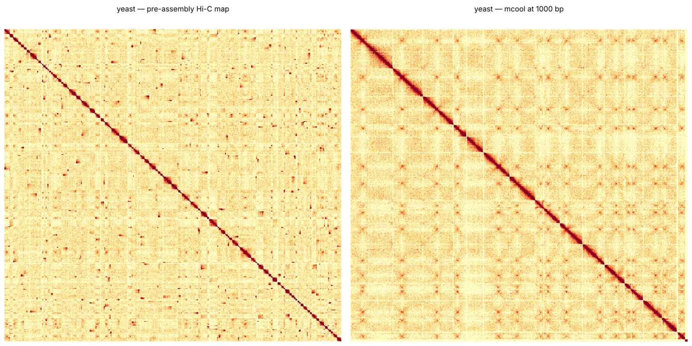

# Why instaGRAAL?

Assemblers stop at contigs: repeats, gaps and low coverage break the
chromosomes into pieces whose order and orientation the reads cannot tell.
A Hi-C library can. Its read pairs join loci that touch in the nucleus (or the
cell), and two loci of one chromosome touch far more often than loci of
different chromosomes, the more so the closer they lie along it. Contigs that
share many contacts are neighbours; the contacts near their ends say which
ends meet.

instaGRAAL scaffolds on that signal. It continues
[GRAAL](https://github.com/koszullab/GRAAL)
([Marie-Nelly *et al.*, *Nature Communications*, 2014](https://doi.org/10.1038/ncomms6695)),
was described in
[Baudry *et al.*, *Genome Biology*, 2020](https://doi.org/10.1186/s13059-020-02041-z),
and is developed by the [Koszul laboratory](https://github.com/koszullab) at
Institut Pasteur.



*The contact map of the 146 contigs of the test data (left), and of the 16
scaffolds `instagraal-endtoend --mode cpu` makes of them (right): each square
along the diagonal is a chromosome of yeast. See the [Quickstart](quickstart.md).*

## What it does

- **One command, from contigs to chromosomes.** `instagraal-endtoend` takes
  the contigs (FASTA) and the Hi-C pairs aligned on them, and writes the
  scaffolds, their layout, their contact maps and their statistics.
- **A model of the contacts.** The MCMC scaffolder scores a layout by how well
  a polymer model of the chromosomes explains the contacts, and changes it
  bin by bin, on an NVIDIA GPU, at a chosen resolution (its *level*).
- **Whole contigs, joined from local evidence.** `instagraal-refine` re-joins
  the input contigs where the contacts next to two contig ends say they meet,
  places the short ones, and closes and recentres circular chromosomes. It
  checks the MCMC layout, and corrects the chromosomes that the MCMC folds
  where the two arms of a bacterial chromosome touch.
- **No GPU needed to start.** `instagraal-endtoend --mode cpu` runs refine
  alone, on any machine; the [modes](guides/pipeline.md#modes) say which steps
  run.
- **The contact maps of the new assembly.** The read pairs are lifted over
  to the scaffolds, into a multi-resolution `.mcool` and cool files that any
  Hi-C tool reads.

## A quick look

```bash
# The Hi-C pairs on the contigs, from the reads, with hicstuff
hicstuff pipeline -g contigs.fa -e DpnII,HinfI -M none -o hicstuff -P sample \
    R1.fq.gz R2.fq.gz

# The contigs and their pairs to chromosomes: out/final_genome.fa
instagraal-endtoend contigs.fa hicstuff/sample.valid_idx.pairs.gz \
    --enzyme DpnII,HinfI --output-dir out

# The input contigs beside the scaffolds
instagraal-stats contigs.fa out/final_genome.fa --labels "Contigs,Scaffolds"
```

The default mode runs the MCMC, which needs an NVIDIA GPU and the `gpu`
extra (see [Installation](installation.md)); `--mode cpu` needs neither. The
[Quickstart](quickstart.md) runs instaGRAAL on test data,
[The end-to-end pipeline](end-to-end.md) goes from the reads to
chromosomes, and [Concepts](concepts.md) explains how it works.
